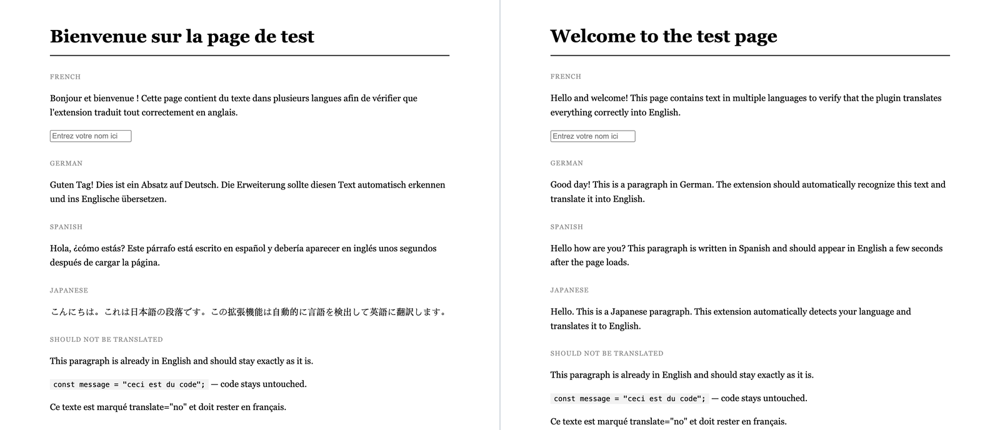
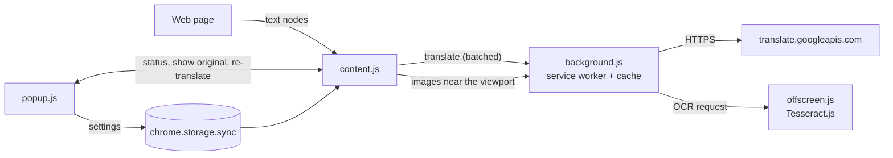
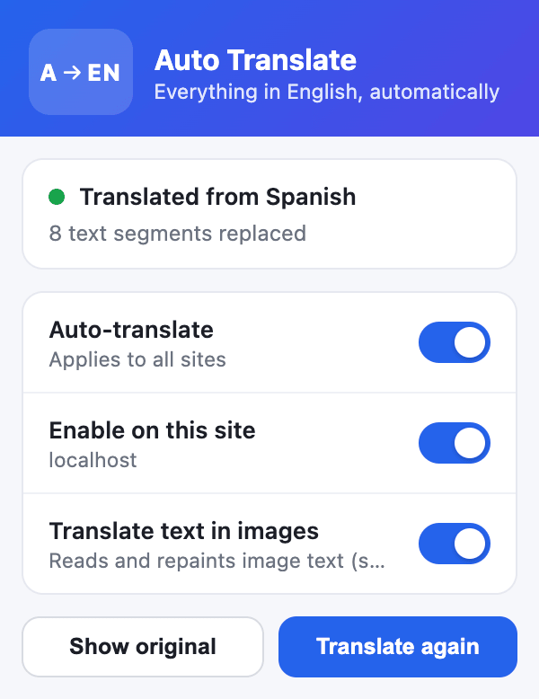

# Auto Translate to English

A Chrome extension that detects the language of a webpage and replaces its text with English in place, without a click.



The bundled [test page](test.html) before and after the extension loads, captured in Chrome 156 on 2026-11-04. The English paragraph, the code sample and the line marked `translate="no"` are left alone, and so is the input's placeholder. The page also has [an image fixture](test-image.png) for OCR translation; it isn't repainted at the moment (see [Known issue](#known-issue)), so it isn't shown here.

## How it works



`content.js` finds the page's text, sends it to the service worker in batches and writes the English back into the same elements. The service worker calls Google's public translation endpoint and keeps an in-memory cache. Images go through an offscreen document that runs Tesseract, then their recognised text is translated the same way.

## Features

- **Automatic language detection** — uses Chrome's built-in detector to identify the page language, plus per-segment detection so mixed-language pages are handled correctly.
- **In-place replacement** — text is swapped directly in the page's own elements, so layout, styling, and interactivity are untouched.
- **Dynamic content support** — new text added by infinite scroll, single-page apps, chat feeds, etc. is translated as it appears.
- **Smart skipping** — pages already in English are left alone, as are code blocks, inputs, URLs, numbers, and elements marked `translate="no"` / `.notranslate`.
- **Show original** — flip back to the untranslated page at any time from the popup.
- **Per-site control** — disable translation globally or for specific sites.
- **No API key required** — uses Google's public web translation endpoint, with caching to minimize requests.
- **Text in images** — recognizes text inside images with on-device OCR (Tesseract), translates it, and repaints the image with English text over the original (Google Lens-style). Toggleable in the popup.

## Installation

1. Open Chrome and go to `chrome://extensions`.
2. Turn on **Developer mode** (toggle in the top-right corner).
3. Click **Load unpacked**.
4. Select this folder (the one with `manifest.json` in it).
5. Visit any non-English webpage — it translates automatically.

## Usage

Just browse. Pages in other languages are translated to English automatically a moment after they load.

Click the extension icon to:

- See the detected language and how many text segments were translated.
- Toggle auto-translate globally or for the current site.
- Switch between the translation and the original text.
- Force a re-translation.



The popup on the bundled test page, captured in headless Chrome on 2026-11-23 with the extension loaded unpacked. The popup was opened as a tab and pointed at the test page's tab; its status, switches and buttons are the real ones. It names one language per page, the one Chrome's detector reports, which on this mixed-language page was Spanish.

## Testing

After loading the extension, serve this folder and open the test page:

```bash
python3 -m http.server 8080
# then visit http://localhost:8080/test.html
```

It has French, German, Spanish and Japanese text, an English paragraph and code that should stay as they are, an image for OCR, and a button that adds foreign-language text after load so you can watch it get translated. Use **Show original** in the popup to switch back. Translation needs a network connection even for a local page.

To open `test.html` as a `file://` page instead, turn on **Allow access to file URLs** for the extension on `chrome://extensions`.

## What leaves your browser

- **Page text.** Every piece of text the extension decides to translate is sent over HTTPS to `translate.googleapis.com`, Google's public translation endpoint. That includes text on pages you are signed in to. Turn the extension off for a site in the popup if you don't want its text sent.
- **Image text.** OCR runs inside the browser (Tesseract compiled to WebAssembly, bundled in `vendor/`). The image itself is not uploaded; only the lines of text recognised in it go to the same translation endpoint. The OCR language data is downloaded from `tessdata.projectnaptha.com` the first time a language is needed.
- **Settings.** The three switches and the list of disabled sites are stored in `chrome.storage.sync`, which Chrome syncs to your Google account if sync is on. Translations are cached in memory only and are gone when the service worker stops.

There is no account, API key or analytics.

### Permissions

| Permission | Why it is asked for |
| --- | --- |
| `<all_urls>` (host) | Read and replace text on any page, and fetch a page's images for OCR |
| `storage` | Save the popup's switches and the disabled-sites list |
| `scripting` | Inject `content.js` into tabs that were already open at install time, or after the extension is reloaded |
| `activeTab` | Access to the tab the popup is opened on |
| `offscreen` | Open the hidden page that runs Tesseract (a service worker can't host it) |

## Known issue

Text in images is not translated at the moment. In Chrome 156 the Tesseract worker fails to start: the offscreen page logs `Failed to execute 'importScripts' on 'WorkerGlobalScope': The script at 'chrome-extension://…/vendor/worker.min.js' failed to load`, and the image is left as it was. Page text is not affected. Reproduced on the bundled test page on 2026-11-23.

## Image translation notes

- Images are processed only as they approach the viewport, one at a time, to keep pages responsive. Small images (icons, thumbnails) are skipped.
- The OCR language model for the page's detected language is downloaded once (a few MB) and cached, so the first foreign-language image on a new language takes longest.
- OCR works best on clear, horizontal text (banners, screenshots, memes). Stylized logos, handwriting, and text on busy photos may be missed — those are left untouched rather than repainted badly.
- CSS `background-image` text is not supported, only `` elements.

## Files

| File | Purpose |
| --- | --- |
| `manifest.json` | Extension manifest (Manifest V3) |
| `background.js` | Service worker that performs translation requests and caching |
| `content.js` | Finds, translates, and replaces page text; watches for dynamic content |
| `popup.html/css/js` | Toolbar popup UI |
| `offscreen.html/js` | Offscreen document that runs the Tesseract OCR engine |
| `vendor/` | Bundled Tesseract.js runtime (OCR) |
| `icons/` | Extension icons |
| `make_icons.py` | Script that generated the icons (not needed at runtime) |
| `test.html`, `test-image.png` | Multi-language test page and its OCR image |
| `docs/screenshots/` | README images |
