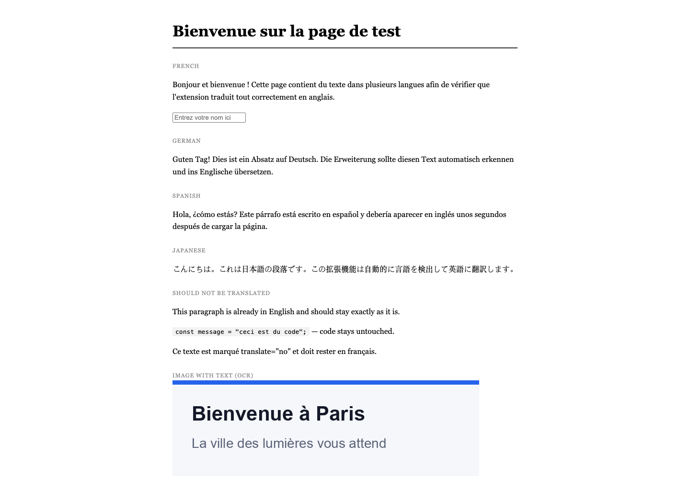

# Auto Translate to English

A Chrome extension that automatically detects the language of any webpage and seamlessly replaces its text with English — no clicks needed.

## Demo page



This is the bundled [test page](test.html) before translation. It is a local browser capture from 2026-09-12, not a translated result.

Load the extension, serve this directory with `python3 -m http.server 8080`, and open `http://localhost:8080/test.html`. Compare the French heading with the translated text, use Show original to switch back, then use the page's button to add dynamic text. English text and code blocks should stay unchanged.

The same page includes [an image fixture](test-image.png) for the OCR toggle. Translation still needs a network connection even when the page is local.

## Features

- **Automatic language detection** — uses Chrome's built-in detector to identify the page language, plus per-segment detection so mixed-language pages are handled correctly.
- **Seamless in-place replacement** — text is swapped directly in the page's own elements, so layout, styling, and interactivity are untouched.
- **Dynamic content support** — new text added by infinite scroll, single-page apps, chat feeds, etc. is translated as it appears.
- **Smart skipping** — pages already in English are left alone, as are code blocks, inputs, URLs, numbers, and elements marked `translate="no"` / `.notranslate`.
- **Show original** — flip back to the untranslated page at any time from the popup.
- **Per-site control** — disable translation globally or for specific sites.
- **No API key required** — uses Google's public web translation endpoint, with caching to minimize requests.
- **Text in images** — recognizes text inside images with on-device OCR (Tesseract), translates it, and repaints the image with English text over the original (Google Lens-style). Toggleable in the popup.

## Installation

1. Open Chrome and go to `chrome://extensions`.
2. Turn on **Developer mode** (toggle in the top-right corner).
3. Click **Load unpacked**.
4. Select this folder (`auto translate`).
5. Visit any non-English webpage — it translates automatically.

## Usage

Just browse. Pages in other languages are translated to English automatically a moment after they load.

Click the extension icon to:

- See the detected language and how many text segments were translated.
- Toggle auto-translate globally or for the current site.
- Switch between the translation and the original text.
- Force a re-translation.

## Testing

Open `test.html` (in this folder) in Chrome after installing the extension — it contains French, German, Spanish, and Japanese text, plus a button that injects new foreign-language text dynamically, so you can watch it get translated live.

To test with a local `file://` page, enable **Allow access to file URLs** for this extension on `chrome://extensions`. Alternatively, serve the page over HTTP:

```bash
python3 -m http.server 8080
# then visit http://localhost:8080/test.html
```

## Image translation notes

- Images are processed only as they approach the viewport, one at a time, to keep pages responsive. Small images (icons, thumbnails) are skipped.
- The OCR language model for the page's detected language is downloaded once (a few MB) and cached, so the first foreign-language image on a new language takes longest.
- OCR works best on clear, horizontal text (banners, screenshots, memes). Stylized logos, handwriting, and text on busy photos may be missed — those are left untouched rather than repainted badly.
- CSS `background-image` text is not supported, only `` elements.

## Files

| File | Purpose |
| --- | --- |
| `manifest.json` | Extension manifest (Manifest V3) |
| `background.js` | Service worker that performs translation requests and caching |
| `content.js` | Finds, translates, and replaces page text; watches for dynamic content |
| `popup.html/css/js` | Toolbar popup UI |
| `offscreen.html/js` | Offscreen document that runs the Tesseract OCR engine |
| `vendor/` | Bundled Tesseract.js runtime (OCR) |
| `icons/` | Extension icons |
| `make_icons.py` | Script that generated the icons (not needed at runtime) |
| `test.html` | Multi-language demo page for testing |
